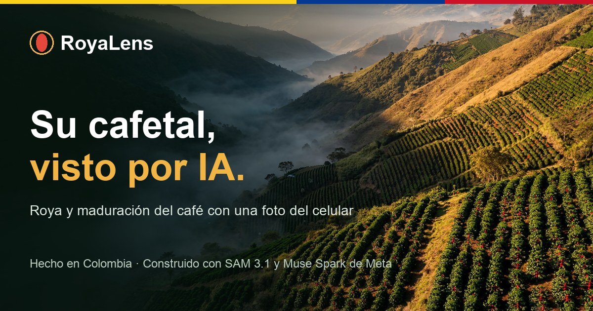
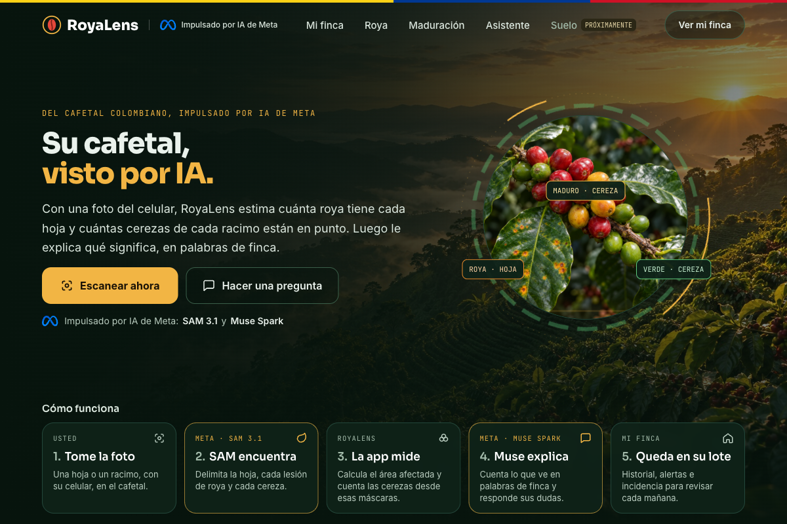
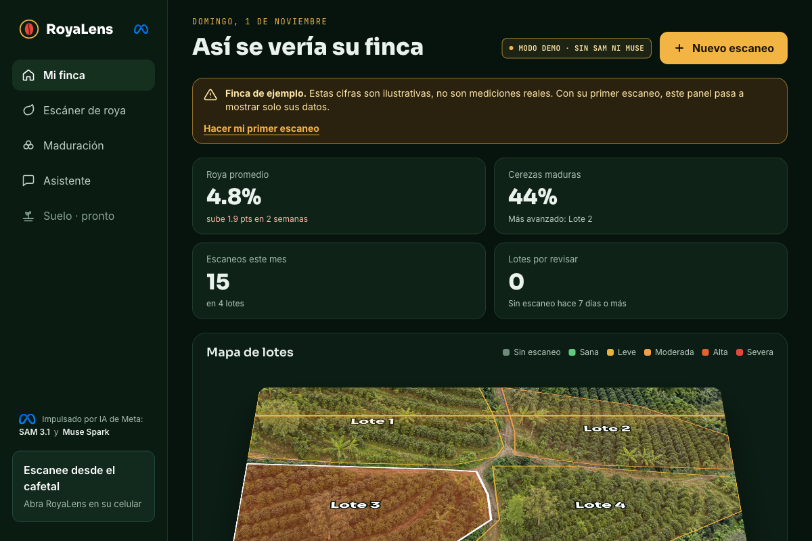
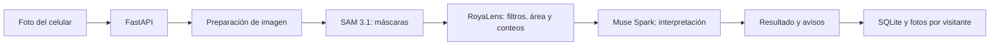

# RoyaLens



**Demo en vivo:** pendiente de publicar · **Video:** pendiente de publicar

## In English

RoyaLens helps coffee growers check leaves and cherry clusters from a phone. Built for the Meta Global AI Developer Hackathon (Indie Developer track, *Build for Your World*).

- **Coffee leaf rust:** SAM 3.1 segments the leaf and its lesions. RoyaLens computes the affected area from those masks, and Muse Spark checks the context and explains the result.
- **Ripeness:** SAM 3.1 finds the visible cherries. RoyaLens counts them and classifies each one by the color inside its mask, and Muse Spark confirms the scene and explains the count.
- **Farm history and assistant:** valid scans are stored per plot, with statistics and a streaming assistant that uses the visitor's scans as context and can search the web.
- **English and Spanish:** the app opens in English. The flag selector at the top switches the whole interface, Muse's explanations and the assistant's answers to Spanish, and back.

Results are estimates from a single photo. They have not been validated against agronomist measurements or field trials.

**Built during the hackathon:** all the code and the features described here were created during the event's building period (October 27 to November 4, 2026). The Git history starts on November 1. Open-source dependencies are listed in `backend/requirements.txt` and `frontend/package.json`.

## Descripción

**RoyaLens** ayuda a revisar hojas y racimos de café desde el celular. Estima qué parte de una hoja está afectada por roya, cuenta cerezas visibles por estado de maduración y guarda los resultados por lote. Un asistente explica los escaneos y responde preguntas sobre el cafetal.

La aplicación está impulsada por **SAM 3.1 y Muse Spark de Meta**. SAM entrega máscaras de imagen; el porcentaje y los conteos los calcula el código de RoyaLens a partir de esas máscaras. Son estimaciones de una foto, no mediciones de campo certificadas.

## La aplicación



*Inicio de la aplicación. La foto del cafetal forma parte de la interfaz.*



*Panel con datos ilustrativos. En una sesión nueva se identifica como «Finca de ejemplo» y se reemplaza por los escaneos del visitante.*

La interfaz incluye cámara, escáner de roya, maduración, panel por lotes, estadísticas y asistente con historial. Está en inglés y en español: abre en inglés y el selector con banderas, arriba en cada pantalla, cambia el idioma. Hay ocho imágenes de ejemplo para probar los flujos sin una finca cerca: dos fotos libres de derechos con crédito visible y seis imágenes generadas con IA, rotuladas como tales. Sus resultados se marcan como ejemplo en el panel.

## Cómo funciona el análisis



### Roya

1. Se reduce la imagen cuando supera el tamaño de trabajo y se envía a SAM 3.1. Una solicitud busca la hoja y otras buscan posibles manchas. Si el primer prompt no encuentra una hoja, se usa uno de respaldo.
2. Se elige una hoja principal, grande y cercana al centro. Las manchas fuera de ella o con color incompatible con roya se descartan. Las máscaras aceptadas se unen para no contar dos veces los píxeles solapados.
3. RoyaLens calcula `píxeles de lesión dentro de la hoja / píxeles de hoja × 100`. También cuenta las lesiones y asigna una clase de severidad orientativa.
4. Muse Spark ve la foto junto con la medición y devuelve una explicación estructurada. Si no se reconoce una hoja medible, la foto parece inadecuada o Muse no confirma el contexto, la app muestra avisos y evita sumar una cifra engañosa al lote.

### Maduración

1. SAM 3.1 busca frutos redondos en la foto completa y en cuatro recortes. El análisis reúne las máscaras y elimina duplicados.
2. RoyaLens examina el color dentro de cada máscara para clasificar las cerezas visibles como **verdes, pintonas, maduras o sobremaduras**. El porcentaje sale del conteo, no de Muse Spark.
3. Muse Spark confirma si la escena parece un racimo de café y explica el resultado. Si hay muy pocas cerezas o están demasiado lejos, se pide repetir la foto y ese porcentaje no entra al panel.

### Idiomas

Los textos fuente de la interfaz están en español y `frontend/src/en.json` guarda su traducción al inglés. El selector guarda el idioma en el navegador y en una cookie; con ella, el servidor pide a Muse Spark que escriba la interpretación y las respuestas del asistente en ese idioma. Las cifras no cambian: salen de las máscaras. Las fotos de ejemplo guardan un resultado por idioma. `make test` comprueba que cada texto de la interfaz y cada mensaje fijo del servidor tenga su traducción.

### Asistente y panel

El asistente recibe el historial del visitante como contexto y transmite la respuesta por partes. Puede consultar la web y presenta las fuentes cuando están disponibles. Las conversaciones se guardan por visitante hasta 30 días, se pueden retomar o borrar desde el historial y también se eliminan con «Borrar mis datos». El panel agrega escaneos válidos por lote para mostrar historial, incidencia sobre las hojas fotografiadas, evolución y alertas.

Los límites del método están resumidos en [HACKATHON.md](HACKATHON.md). En particular, falta contrastar los porcentajes con mediciones de un agrónomo y ampliar las pruebas con fotos de campo colombiano.

## Arquitectura del repositorio

| Ruta | Función |
|---|---|
| `frontend/src/pages/` | Las seis pantallas de React |
| `frontend/src/components/ui.jsx` | Componentes, navegación y avisos compartidos |
| `frontend/src/api.js` | Solicitudes a la API y lectura del stream del asistente |
| `frontend/src/i18n.js`, `frontend/src/en.json` | Idioma activo, selector y traducciones al inglés |
| `backend/main.py` | Rutas FastAPI, validación de archivos, cookie de visitante y entrega del frontend |
| `backend/service.py` | Orquestación de los análisis real y demo |
| `backend/store.py` | SQLite, historial, fotos, límites de uso y retención |
| `backend/chat.py`, `backend/ejemplos.py` | Asistente y catálogo de fotos de ejemplo |
| `royalens/royalens/meta_api.py` | Llamadas a SAM 3.1 y Muse Spark mediante Meta Model API |
| `royalens/royalens/analysis.py` | Filtros, máscaras, porcentajes, conteos y anotaciones |
| `royalens/royalens/pipeline.py` | Flujos completos de roya y maduración |
| `backend/tests/`, `royalens/tests/` | Pruebas sin llamadas de pago a los modelos |
| `scripts/` | Evaluaciones opcionales con fotos locales; consumen créditos de API |

El frontend se compila con Vite. En producción, FastAPI sirve la compilación y la API desde un solo contenedor. SQLite y las fotos se guardan en `/data` cuando se usa Docker.

## Desarrollo local

Se necesitan Python 3.12, `uv` y Node.js 22.

```bash
make setup
make backend
```

En otra terminal:

```bash
make frontend
```

Abra `http://localhost:5173`. `make backend` inicia el **modo demo**: usa segmentación local por color, no llama a Meta y marca los resultados como demostración. El asistente requiere el modo real.

Para usar los modelos, copie `royalens/.env.example` a `royalens/.env`, defina `MODEL_API_KEY` y ejecute `make backend-real`. El archivo `.env` está excluido de Git.

## API

| Método y ruta | Uso |
|---|---|
| `GET /api/estado` | Modo activo y lotes disponibles |
| `POST /api/roya` | Analizar una hoja (`foto`, `lote`) |
| `POST /api/maduracion` | Analizar un racimo (`foto`, `lote`) |
| `GET /api/ejemplos/{tipo}` | Listar fotos de ejemplo de roya o maduración |
| `POST /api/ejemplos/{slug}` | Analizar o reutilizar un ejemplo |
| `GET /api/escaneos/{id}` | Leer un escaneo del visitante |
| `GET /api/resumen` | Panel del visitante |
| `POST /api/chat` | Respuesta del asistente en NDJSON |
| `DELETE /api/mis-datos` | Borrar los escaneos del visitante |

Las imágenes originales y anotadas se entregan por `/media/{nombre}` tras comprobar la cookie y la propiedad del escaneo.

## Datos y despliegue

El `Dockerfile` compila React y arranca FastAPI en el puerto **8000** y en **modo real**. Para desplegar, configure `MODEL_API_KEY` como secreto, HTTPS para la cámara y un volumen persistente en `/data`. El health check consulta `/api/estado`. La [guía del hackathon](HACKATHON.md) contiene las variables de entorno y la revisión posterior al despliegue.

Cada navegador recibe una cookie anónima. Los escaneos se separan por visitante y por modo; las fotos se eliminan junto con el escaneo al usar «Borrar mis datos» o al vencer la retención de 30 días. Los límites diarios de análisis y chat se configuran con las variables `ROYALENS_LIMITE_*`. Las ocho imágenes de ejemplo comparten un resultado de análisis almacenado para evitar llamadas repetidas a la API.

## Verificación

```bash
make test
make build
```

Las pruebas usan respuestas simuladas de los modelos y no consumen créditos. Los scripts de `scripts/` permiten repetir evaluaciones con fotos locales en `fotos/`; esa carpeta está excluida del repositorio porque contiene imágenes de terceros usadas para calibrar.

## Créditos de imágenes

Los créditos de las imágenes de ejemplo están en `backend/ejemplos.py` y se muestran junto a cada una en la app. `racimo-mixto` es de dominio público y `racimo-verde` es CC0. Las imágenes generadas se identifican como tales; `hoja-roya`, `hoja-sana`, `hoja-otra-mancha` y `racimo-rojo` se crearon con Muse Image. El [símbolo de Meta](https://commons.wikimedia.org/wiki/File:Meta_Platforms_logo.svg) se usa con la autorización confirmada por el responsable del proyecto.

## Licencia

El código se distribuye bajo la [licencia MIT](LICENSE). Esa licencia no cubre las fotos de ejemplo de terceros ni el símbolo de Meta; cada uno conserva sus propios términos.
