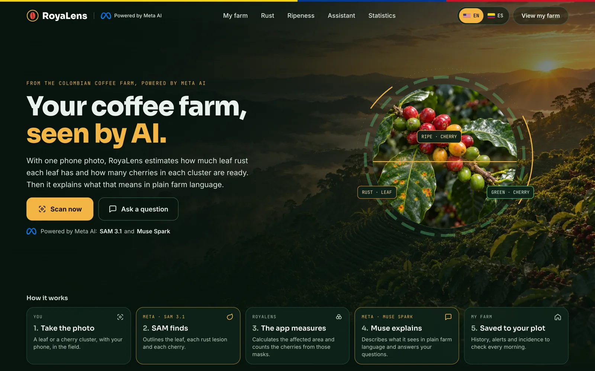
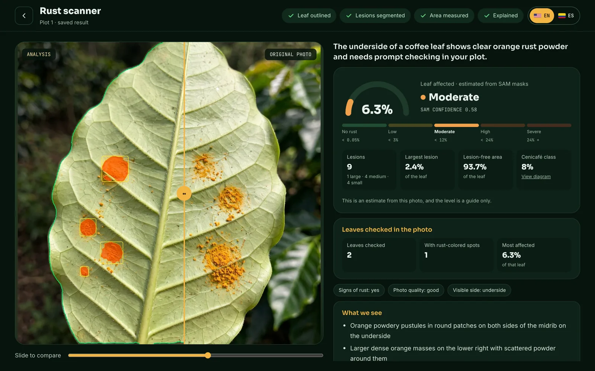
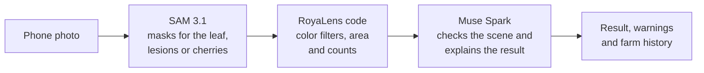
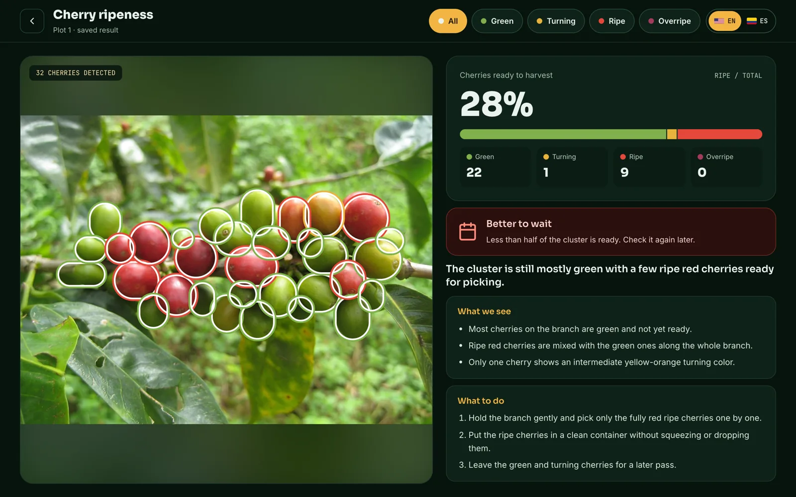
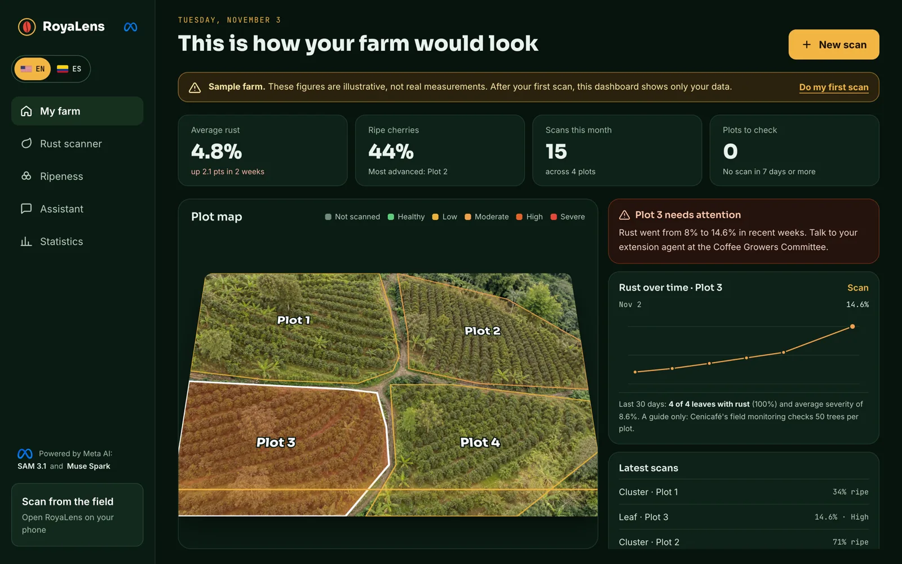

# RoyaLens

**Your coffee farm, seen by AI.** RoyaLens turns a phone photo into a coffee leaf rust measurement, a cherry ripeness count and a farm dashboard, powered by Meta SAM 3.1 and Muse Spark.

**[▶ Try the live app: royalens.scirelabs.com](https://royalens.scirelabs.com/)** · **[▶ Demo video](https://youtu.be/rVMMJ_D1gXc)** · **[Leer en español](README.es.md)**

Built for the **Meta Global AI Developer Hackathon** · Indie Developer track · *Build for Your World*



## The problem

Coffee leaf rust (*Hemileia vastatrix*) causes the largest economic losses in coffee worldwide, according to Cenicafé, Colombia's coffee research center. It starts as small yellow-orange spots on the underside of the leaf, and by the time a plot looks sick, the harvest is already at risk. Checking leaves one by one takes time, and an extension agent can't visit every farm every week.

Harvest has the same problem: picking green or overripe cherries lowers cup quality, so growers need to know when a cluster is really ready.

RoyaLens brings Meta's models from the office to the coffee field, on the phone a grower already has.

## What it does

| | |
|---|---|
| **Leaf rust scanner** | Measures what percentage of a leaf is affected, counts lesions and places the result on a five-level scale aligned with Cenicafé's standard area diagram. |
| **Ripeness counter** | Finds every visible cherry and classifies it as green, turning, ripe or overripe, then says whether it's time to harvest. |
| **My farm** | Saves each valid scan to one of four plots, with a plot map, alerts, trends, incidence and severity. |
| **Assistant** | Answers questions using the grower's own scans as context, searches the web when needed and shows its sources. It never gives chemical doses: it refers the grower to their extension agent. |
| **English and Spanish** | The app opens in English. The flag selector switches the interface, Muse's explanations and the assistant's answers to Spanish, and back. |



## How Meta's models work together

The key design decision: **the number never comes from a language model.** SAM finds, RoyaLens measures and Muse explains.



| Meta model | Role in RoyaLens |
|---|---|
| **SAM 3.1** | Segments the leaf and each possible lesion with text prompts. For ripeness, segments every round fruit in the full photo and in four overlapping tiles, so dense clusters aren't missed. |
| **Muse Spark 1.3** | Looks at the same photo plus the measurement and returns structured JSON: whether it's really a coffee leaf or cluster, photo quality, visible side of the leaf, signs of rust and a plain-language explanation. It also powers the streaming assistant, with web search and citations. |
| **Muse Image** | Generated four of the in-app sample images, so judges and new users can try every flow without being on a farm. |

### Leaf rust

1. SAM 3.1 receives the photo with one prompt for the leaf and others for possible lesions.
2. RoyaLens picks the main leaf, discards spots outside it or with a color that doesn't match rust, and merges overlapping masks so no pixel is counted twice.
3. The severity is `lesion pixels inside the leaf / leaf pixels × 100`, plus the lesion count, the largest lesion and the Cenicafé class.
4. Muse Spark checks the context. If the photo isn't a coffee leaf, shows the upper side with no visible lesions, or is too poor to trust, the app explains why and **doesn't add a misleading number to the plot**.

### Ripeness

1. SAM 3.1 finds the cherries, and RoyaLens removes duplicates across tiles.
2. Each cherry is classified by the color inside its own mask. The ripe percentage comes from the count, not from Muse.
3. Muse Spark confirms that it's a coffee cluster and explains the result. With too few cherries, or cherries too far away, the app asks for a new photo.



## Try it

1. Open **[royalens.scirelabs.com](https://royalens.scirelabs.com/)**. No account needed.
2. Go to **Rust** or **Ripeness** and pick a sample photo, or upload your own.
3. Open **My farm** and **Statistics** to see the scan in its plot. Before your first scan, a clearly labeled sample farm shows what the dashboard looks like.
4. Ask the **Assistant** about the result, then switch the flag to Spanish.

Each browser gets an anonymous cookie, so visitors never see each other's data. Photos and conversations are kept for 30 days and can be deleted with **Delete my data**. The first analysis of each sample takes about 30 seconds; after that its result is reused instantly.



## Built during the hackathon

All the code and features described here were created during the event's building period (October 27 to November 4, 2026). The Git history starts on November 1. Open-source dependencies are listed in `backend/requirements.txt` and `frontend/package.json`.

## Limitations

Results are **estimates from a single photo**, not certified field measurements:

- Thresholds were tuned on a small set of test photos. They haven't been compared against measurements by an agronomist.
- Lighting changed one leaf measurement by up to about 10 points in our tests.
- Hidden cherries aren't counted, and shade or yellow-fruited varieties can affect the color classification.
- Very advanced rust, where pustules merge into one large patch, can be under-measured.

Details are in [HACKATHON.md](HACKATHON.md) (in Spanish).

## Tech stack

- **Frontend:** React 19, Vite, Tailwind CSS and Framer Motion. Mobile-first, with live camera capture.
- **Backend:** FastAPI, SQLite, Pillow, NumPy and SciPy. HEIC photos from iPhone are supported.
- **AI:** Meta Model API through the OpenAI SDK and `meta-sam-parser`.
- **Deployment:** one Docker container that serves the API and the compiled frontend, on Coolify with HTTPS and a persistent `/data` volume.

### Repository

| Path | Purpose |
|---|---|
| `frontend/src/pages/` | The seven React screens |
| `frontend/src/i18n.js`, `frontend/src/en.json` | Language selector and English translations |
| `backend/main.py` | FastAPI routes, upload checks, visitor and language cookies |
| `backend/service.py` | Orchestration of the real and demo analyses |
| `backend/store.py` | SQLite history, photos, usage limits and retention |
| `backend/chat.py` | Muse Spark assistant with farm context and web search |
| `royalens/royalens/meta_api.py` | Calls to SAM 3.1 and Muse Spark |
| `royalens/royalens/analysis.py` | Color filters, masks, percentages, counts and overlays |
| `royalens/royalens/pipeline.py` | Full rust and ripeness pipelines |
| `backend/tests/`, `royalens/tests/` | Tests with mocked model calls, so they cost no credits |

## Run it locally

Requires Python 3.12, `uv` and Node.js 22.

```bash
make setup
make backend
```

In another terminal:

```bash
make frontend
```

Open `http://localhost:5173`. `make backend` starts **demo mode**: local color segmentation, no calls to Meta, results labeled as a demo. To use the real models, copy `royalens/.env.example` to `royalens/.env`, set `MODEL_API_KEY` and run `make backend-real`.

```bash
make test
make build
```

`make test` runs the backend tests and checks that every interface text and fixed server message has an English translation.

## Deploy

The `Dockerfile` builds React and starts FastAPI on port **8000** in real mode. Set `MODEL_API_KEY` as a secret, serve it over HTTPS (the live camera needs it) and mount a persistent volume at `/data`. The health check calls `/api/estado`. Optional daily limits: `ROYALENS_LIMITE_ANALISIS_IP` (default 40), `ROYALENS_LIMITE_ANALISIS` (800), `ROYALENS_LIMITE_CHAT_IP` (60) and `ROYALENS_LIMITE_CHAT` (1500).

## Image credits

Credits for the sample images are in `backend/ejemplos.py` and appear next to each one in the app. `racimo-mixto` is public domain and `racimo-verde` is CC0. The other six are AI-generated and labeled as such; `hoja-roya`, `hoja-sana`, `hoja-otra-mancha` and `racimo-rojo` were made with Muse Image. The [Meta symbol](https://commons.wikimedia.org/wiki/File:Meta_Platforms_logo.svg) is used with the authorization confirmed by the project owner.

## License

The code is released under the [MIT License](LICENSE). The license doesn't cover third-party sample photos or the Meta symbol, which keep their own terms.
